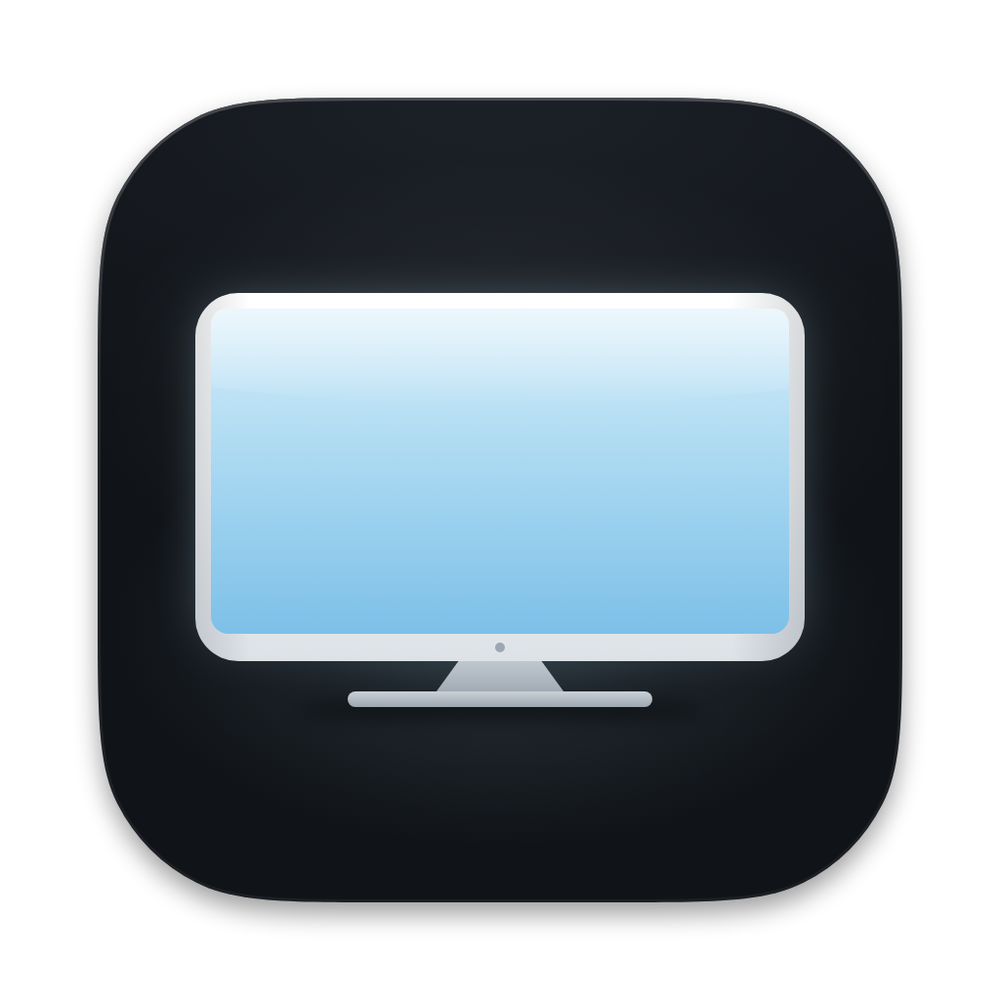
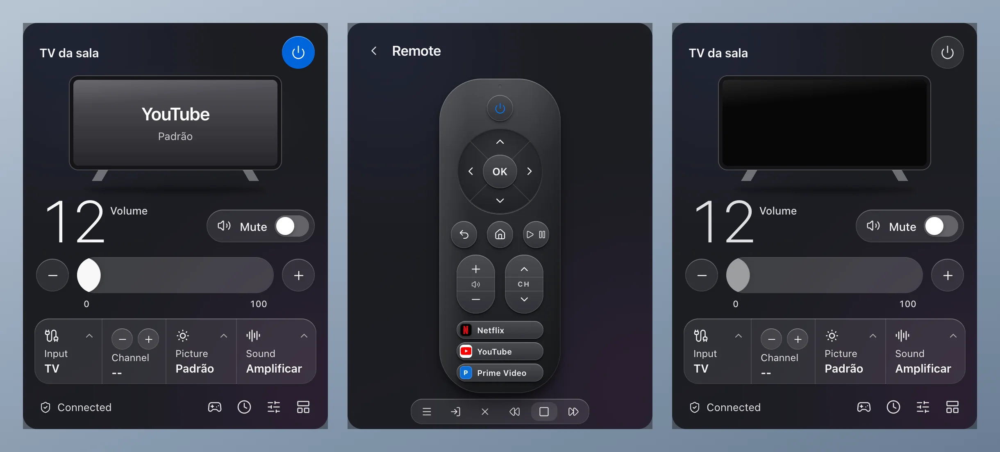
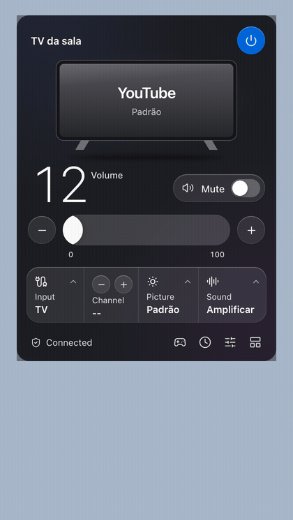
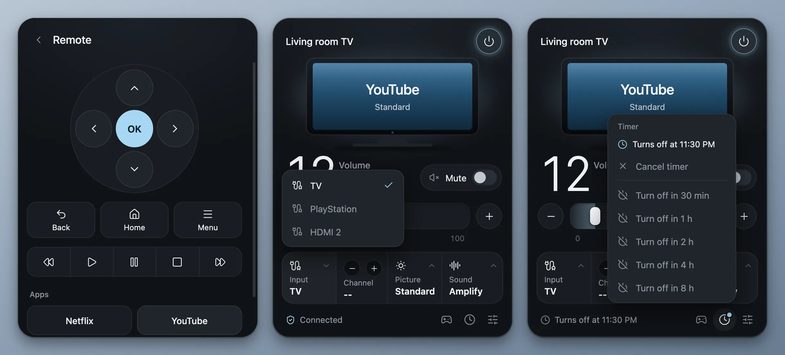
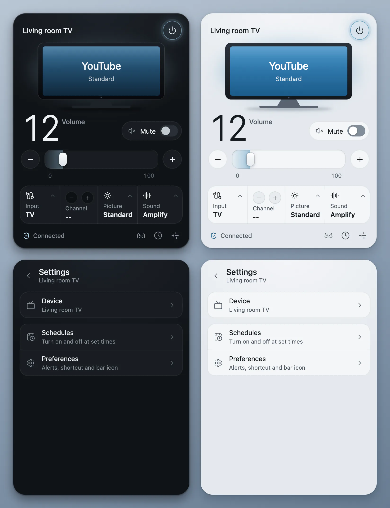
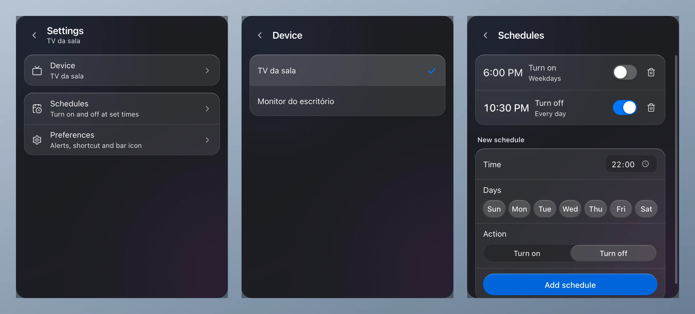

<p align="right"><a href="README.md">Português</a> · <b>English</b></p>

<div align="center">
  
  <h1>TV Remote</h1>
  <p>Control your Samsung TV from the Mac menu bar, through SmartThings.</p>
</div>

<p align="center">
  <a href="https://github.com/kevinnfsilva/samsung-tv-menubar-app/releases/latest/download/TVRemote-arm64.dmg"></a>
  &nbsp;
  <a href="https://github.com/kevinnfsilva/samsung-tv-menubar-app/releases/latest/download/TVRemote-x64.dmg"></a>
</p>

<p align="center">
  <sub>Not sure which Mac you have? Apple menu &gt; <b>About This Mac</b>: "Chip" means Apple Silicon, "Processor" means Intel. Needs macOS 13 or newer. For Windows, see <a href="#on-windows">On Windows</a>.</sub>
</p>

<p align="center">
  <a href="https://kevinnfsilva.github.io/samsung-tv-menubar-app/">Download page</a> ·
  <a href="https://github.com/kevinnfsilva/samsung-tv-menubar-app/releases/latest">Release notes</a>
</p>

<p align="center">Prefer to install without the macOS warning? Paste this line into Terminal:</p>

```sh
curl -fsSL https://raw.githubusercontent.com/kevinnfsilva/samsung-tv-menubar-app/main/install.sh | bash
```

<div align="center">
  <p>
    <a href="https://github.com/kevinnfsilva/samsung-tv-menubar-app/releases/latest"></a>
    
    
  </p>
  <p>
    <a href="#download-for-mac">Download for Mac</a> ·
    <a href="#what-it-does">What it does</a> ·
    <a href="#usage">Usage</a> ·
    <a href="#run-from-source">Source code</a> ·
    <a href="#on-windows">Windows</a> ·
    <a href="#common-problems">Common problems</a>
  </p>
</div>

<p align="center">
  
</p>

A menu bar panel for the Mac that controls a Samsung TV through SmartThings. The icon shows the volume, and one click opens the panel: power, volume, mute, input, picture, sound, channel and an on-screen remote, with shortcuts to Netflix, YouTube, Prime Video and Disney+.

This project grew out of [WindFree](https://github.com/kevinnfsilva/samsung-windfree-menubar-app), the Samsung air conditioner panel, and uses the same code with the TV part in place of the air conditioner part. WindFree, in turn, is based on the [Windows tray app](https://github.com/c0dag/samsung-windfree-tray-app) by [@c0dag](https://github.com/c0dag), ported to the macOS menu bar.

<p align="center">
  
</p>

<p align="center"><sub>The images and the demo come from the real panel code, with a simulated TV. The pointer in the video was drawn on top.</sub></p>

## Download for Mac

You need:

- macOS 13 or newer
- Your TV already set up in the SmartThings app, on a Samsung account

You do not need to install Node.js: the installed app brings everything it uses.

Pick the file for your Mac. The links always point to the latest release:

| Your Mac | File |
|---|---|
| Apple Silicon (M1 or newer) | [`TVRemote-arm64.dmg`](https://github.com/kevinnfsilva/samsung-tv-menubar-app/releases/latest/download/TVRemote-arm64.dmg) |
| Intel | [`TVRemote-x64.dmg`](https://github.com/kevinnfsilva/samsung-tv-menubar-app/releases/latest/download/TVRemote-x64.dmg) |

Not sure? Open the Apple menu and choose **About This Mac**. If it says "Chip", it is Apple Silicon. If it says "Processor", it is Intel.

The same choices, with explanations, are on the [download page](https://kevinnfsilva.github.io/samsung-tv-menubar-app/). There are two ways to install: from the Terminal, without the macOS warning, or by opening the DMG.

### Install from Terminal (no warnings)

Paste this line into Terminal (in Applications > Utilities) and press Return:

```sh
curl -fsSL https://raw.githubusercontent.com/kevinnfsilva/samsung-tv-menubar-app/main/install.sh | bash
```

The script downloads the right DMG for your Mac (Apple Silicon or Intel), checks that the app inside is TV Remote, copies **TV Remote.app** into the **Applications** folder and opens it. It does not use `sudo` and does not ask for your password: if Applications is not writable for your user, it uses `~/Applications`. If TV Remote is already installed, the old copy is replaced. With the app open, the script asks it to quit and waits a few seconds; if it does not quit, the script stops without changing anything and asks you to quit from the icon's menu.

**Why does this avoid the warning?** macOS only shows the warning for files with the quarantine mark ("downloaded from the internet"), which browsers put on everything they download. `curl` does not put that mark, so an app installed this way opens normally. The app is still not notarized; it just skips the first-launch block.

The script is [`install.sh`](install.sh), plain text you can read before running it. It only deletes its own temporary folders and the previous `TV Remote.app`. For tests or mirrors it accepts three environment variables: `TVREMOTE_DMG_URL` (download this DMG instead of the latest release's), `TVREMOTE_INSTALL_DIR` (install into this folder instead of Applications) and `TVREMOTE_NO_OPEN=1` (do not open the app at the end). Messages are in Portuguese when the Terminal language (`LC_ALL`, `LC_MESSAGES` or `LANG`) is Portuguese, and in English otherwise.

### Install from the DMG

1. Open the DMG and drag **TV Remote** to the **Applications** folder.
2. Open TV Remote from the Applications folder. The first time, macOS blocks it; see just below for how to allow it.
3. The panel opens right away. The app gets an icon in the menu bar, near the clock, and another in the Dock. To keep it in the menu bar only, turn off **Show the icon in the Dock** in **Settings > Preferences**.

The app does not update itself. To switch versions, run the Terminal command above again. Or quit the app, download the new DMG and replace the app in the Applications folder; in that case you may have to allow it to open again.

### Allow the first launch

This applies to the DMG downloaded with a browser. If you install [from Terminal](#install-from-terminal-no-warnings), you skip it.

TV Remote is not notarized (authenticated) by Apple. Notarization needs a paid developer account, which this project does not have, so the app ships with a local (ad-hoc) signature only. That is why macOS blocks the first launch.

To allow it:

1. Try to open TV Remote and dismiss the warning, without moving the app to the Trash.
2. Open **System Settings > Privacy & Security** and scroll down to **Security**.
3. Click **Open Anyway** next to the warning about TV Remote and confirm with your password or Touch ID.

If you prefer the Terminal, this command removes the block:

```sh
xattr -dr com.apple.quarantine "/Applications/TV Remote.app"
```

It removes the quarantine mark macOS puts on files downloaded from the internet. After that the app opens normally.

If you would rather not trust a non-notarized app, you can [run from source](#run-from-source). It is the same program.

### First use

1. The panel opens with **Sign in to your Samsung account**. Click **Sign in**.
2. Your browser opens with the official SmartThings sign-in. Sign in and authorize. Meanwhile the panel shows "Waiting for sign-in in the browser…", with a **Cancel** button.
3. When the sign-in finishes, the app looks for the TVs on the account and uses one that is responding (or the first on the list, if none responds). If you have more than one, pick the right one in [**Settings > Device**](#more-than-one-tv-on-the-same-account). The menu bar icon, which shows `--` while connecting, shows the volume once the TV is on.

The browser only opens when you click **Sign in**, in the panel or in the icon's menu. The app waits for the sign-in for about 10 minutes; after that the panel goes back to "Sign in to your Samsung account". **Cancel**, or quitting the app, ends the sign-in and leaves no process running in the background. These two guarantees, never opening the browser by itself and leaving no processes behind, hold on the Mac only.

After that the app starts by itself with macOS, without opening the panel. You can turn that off in the icon's menu or in **Settings > Preferences**.

With a full menu bar, which is common on MacBooks with a notch, the new icon may be hidden. Hold ⌘ and drag icons to rearrange them, or close one you do not use. Clicking the app's icon in the Dock, or opening TV Remote again from the Applications folder, also shows the panel.

## What it does

- Switch the TV on and off from the panel button, from the menu bar icon, or with the Space key.
- Set the volume from 0 to 100 with the slider, the − and + buttons or the ↑ and ↓ keys. Turn mute on and off.
- Change the **input**, the **picture mode** and the **sound mode**. The options are the ones the TV reports.
- Change channel with the − and + buttons on the **Channel** cell, when the TV reports its channel.
- Use the **Remote**: directional pad, OK, Back, Home, Menu, playback buttons and shortcuts to Netflix, YouTube, Prime Video and Disney+.
- Set a **timer** (30 minutes to 8 hours) and **schedules** by time and weekday.
- Get notifications: the TV going offline, and the TV being left on for a long time.
- Open the panel with a global shortcut (off by default).
- Pick which TV to use, when the account has more than one.
- Light or dark appearance, following the system, and screens in Portuguese or English.
- Show the volume in the menu bar icon, start with macOS, hide the Dock icon, and find out when a new version is out.

Tested on a Samsung Crystal UHD 75-inch (UN75CU8000): power on and off over the network, volume, mute, picture mode, sound mode, launching YouTube and Netflix, the Home key and the channel keys worked. The arrow keys, Back and play/pause are sent, but the TV does not report whether the screen changed. Picture mode only changes while something is playing. Timer, schedules and notifications were tested only with a simulated TV. The Prime Video and Disney+ shortcuts were not tried on the TV. The Intel installer and Windows were not run.

## Usage

### The menu bar icon

- With the TV on, the icon is a solid TV followed by the volume. With it off, it is an outlined TV with a power symbol and no number. With no TV data (signed out, or before the first reading), it is an outlined TV with `--`.
- With mute on, a line runs across the TV drawing.
- Hold the mouse still over the icon to see the TV's name, whether it is on, its volume and its input.
- Click the icon to open the panel. Click again, click outside or press Esc to close it.
- Right-click (or two-finger click on the trackpad) to open the menu: **Open panel**, **Turn on** or **Turn off**, **Mute** (checked while mute is on), **Refresh now**, **Open at login** and **Quit**. When signed out, the menu shows **Sign in to your Samsung account** instead of the TV commands.
- To show or hide the volume in the icon, use **Show the volume in the icon** in **Settings > Preferences**.
- To quit the app for good, use **Quit** in the icon's menu.

### The panel

From top to bottom:

- The TV's name and the button that turns the TV on and off.
- The TV screen: it shows the app in use (YouTube, Netflix and others the app recognizes) or, if none is recognized, the input, with the picture mode below it. With the TV off, the screen is dark.
- The volume as a large number, the **Mute** switch, the slider and the − and + buttons.
- Four cells: **Input**, **Channel** (with − and +), **Picture** and **Sound**. Input, Picture and Sound open a list of the options the TV reports.
- The footer shows the status, such as "Connected", "Syncing…" or "The TV is offline", and has the **Remote**, **Timer** and **Settings** buttons.

When something goes wrong, the footer says what: "No internet or SmartThings is down", "The TV is offline", "No TV on this account", "This TV is no longer on the account" (with the **Choose another TV** shortcut), "SmartThings took too long to respond" or "SmartThings is not responding". Almost all of them come with **Try again**. When the TV does not confirm a change, the footer says which settings were left unconfirmed.

### Remote

<p align="center">
  
</p>

Click the remote icon in the footer. The **Remote** page has:

- The directional pad (↑, ←, OK, →, ↓), with **Back**, **Home** and **Menu** below it.
- The playback buttons: rewind, play, pause, stop and fast forward.
- **Apps**, with **Netflix**, **YouTube**, **Prime Video** and **Disney+**, which open the app on the TV.

With the page open, the keyboard arrows are the directional pad, Enter is OK (when no button has focus) and Backspace is Back. Each press goes to the TV in the order you made it. The remote goes through SmartThings, so each press takes a second or two; moving through menus with the arrows is slower than with the physical remote.

### Timer and schedules

**Timer.** Click the clock in the footer. With the TV on, the options are "Turn off in 30 min", 1 h, 2 h, 4 h and 8 h; with the TV off, they are the same to turn it on. The footer shows "Turns off at…" or "Turns on at…" while the timer is active, and **Cancel timer** undoes it. There is only one timer at a time.

**Schedules.** In **Settings > Schedules**, choose the time, the weekdays and the action (**Turn on** or **Turn off**). The days can be every day, weekdays, weekends or any combination. Each schedule has a switch to enable or disable it and a trash can.

A few rules apply to the timer and the schedules:

- Each one is tied to the TV that was in use when it was created and acts on that TV, even if you pick another TV later.
- They only run while TV Remote is open. While the Mac is asleep the app does not act; a switch-off timer that came due in that time fires when the Mac wakes up.
- If the command cannot be delivered (no internet, SmartThings down), the app retries every minute, for up to 10 minutes, and then shows a notification that it could not turn the TV on or off. If you quit the app in the meantime, it picks up again when you reopen it. Switching the TV on or off by hand cancels the pending retries.
- A switch-off timer that came due while the Mac was asleep, or the app was closed, fires as soon as the app is running again. A switch-on timer that is more than 5 minutes late is dropped, and the app notifies you.
- A schedule only fires in its exact minute. If the app is closed or the Mac is asleep in that minute, it is not made up for later.

### Notifications

In **Settings > Preferences** you can turn each notification on or off:

- **Notify if the TV goes offline**: when the TV loses its connection.
- **Notify if it stays on for**: Never, 4 h, 8 h or 12 h.

Besides these, the app always tells you when a timer or a schedule cannot turn the TV on or off, and when a turn-on timer is dropped for being late. These notifications have no switch.

### Shortcuts

- The **Global shortcut** opens and closes the panel from anywhere. It stays off until you turn it on in **Settings > Preferences**. On the Mac it is ⌃⌥W (Control + Option + W). If another app already uses that combination, the switch turns itself off again and the panel says "Shortcut in use or invalid." You cannot change the combination from the panel.
- With the panel open and no menu or settings open: ↑ and ↓ change the volume by 1, **M** toggles mute and **Space** turns the TV on or off.
- **Esc** goes back one step: it closes the open menu, then the settings page, then the settings, and finally the panel.
- Right after opening, the panel ignores these keys for about 0.7 seconds, and they do nothing while the TV is not reachable.

### Appearance and language

The panel follows the system's light or dark mode.

<p align="center">
  
</p>

The language is in **Settings > Preferences > Language**: Automatic, Português or English. With Automatic, the app uses Portuguese when macOS is in Portuguese and English in any other case. The icon's menu and the notifications follow the same language.

### Settings

<p align="center">
  
</p>

**Settings** has three pages: **Device** (the list of TVs on the account), **Schedules** and **Preferences**. Preferences holds the notifications, the global shortcut, the volume in the icon (Mac only), **Show the icon in the Dock** (Mac only), **Open at login**, **Check for new versions** and the **Language**.

### New versions

The app does not update itself, but it tells you: when it opens and then once a day, it checks the project's releases page on GitHub. When a newer version is out, a dot appears on the settings button, a row with a **Download** button shows at the top of the settings, and the icon's menu gets an item. The button opens the release page; installing is still up to you. To stop the app from checking, turn off **Check for new versions** in Preferences.

### Open at login

After the first launch the app starts by itself when you log in to the Mac, with the panel closed. To turn that off, uncheck **Open at login** in the icon's menu or in **Settings > Preferences**.

Under the hood it is a LaunchAgent: the file `~/Library/LaunchAgents/io.github.kevinnfsilva.tvremote.plist`. macOS may warn that a background item was added. If you move the app, quit it with **Quit** and open it again to update the autostart.

## More than one TV on the same account

Open **Settings > Device**. The list shows the TVs on the account; click the one you want to control. If the TV you were using left the account, the panel says "This TV is no longer on the account" and the **Choose another TV** shortcut takes you to that list.

Samsung monitors also appear on the list, because the app recognizes any device with the TV channel feature.

The app saves your choice in the `device.json` file. You do not need to touch it, but it helps to know where it lives:

- Installed app on the Mac: `~/Library/Application Support/TV Remote/device.json`
- Running from source: `device.json` in the project folder

Deleting `device.json` makes the app look again and pick a TV on the account.

## Run from source

Works on Mac and Windows. On Windows it is the only way, because there is no installer.

Requirements:

- macOS 13 or newer, or Windows 10 or 11
- [Node.js](https://nodejs.org) 24.8 or newer (what the SmartThings CLI asks for)
- Your TV already set up in the SmartThings app, on a Samsung account

Download the code:

```sh
git clone https://github.com/kevinnfsilva/samsung-tv-menubar-app.git
```

Go into the folder:

```sh
cd samsung-tv-menubar-app
```

Install the dependencies:

```sh
npm install
```

Start the app:

```sh
npm start
```

Without git, download with the **Code > Download ZIP** button, extract it and run `npm install` and `npm start` inside the folder.

First use is the same as the installed app's: the panel asks for the sign-in, you click **Sign in**, the app picks a TV on the account and the icon appears. The `device.json` stays in the project folder.

After that it starts by itself with the system. If you move the folder, quit the app and run `npm start` again to update the autostart.

### Build the Mac installers

On a Mac, after `npm install`:

```sh
npm run dist
```

The `TVRemote-arm64.dmg` and `TVRemote-x64.dmg` files land in the `dist/` folder.

## On Windows

On Windows the app runs straight from the project folder, with Node.js. There is no installer: follow the steps in [Run from source](#run-from-source).

**Windows was not tested for this version.** The tray code is still in the project, but it has not been run.

- The icon with the volume sits in the tray, next to the clock. When the TV is on, the number gets a colored line under it; when off, the icon is dimmer.
- Windows 11 hides new icons behind the ^ arrow in the tray. To keep the icon always visible, drag it to the bar or turn it on in **Settings > Personalization > Taskbar > Other system tray icons**.
- Click the icon to open the panel. Click outside or press Esc to close it.
- Right-click the icon to sign in, turn the TV on or off, mute, refresh, choose whether it opens at login, or quit.
- The panel does not open by itself when you start the app, and there is no Dock icon or option to show one. The global shortcut, when turned on, is Ctrl+Alt+Shift+W.
- After the first time it starts by itself with Windows. If you move the folder, run `npm start` again to update the autostart.

## How it works

- The app talks to the TV through the official SmartThings API, using the [SmartThings CLI](https://github.com/SmartThingsCommunity/smartthings-cli) sign-in. That sign-in renews itself and only asks you to sign in again after 30 days of not being used. SmartThings personal access tokens expire in 24 hours, which is why the app does not use that route. There is no local network mode: everything goes through the SmartThings servers.
- `tv.mjs` turns actions into SmartThings commands, checks that the TV applied each setting and turns failures into error codes.
- `bridge.js` manages the command queue. Volume changes made in a row become a single command; each key of the Remote and each tap on an app is its own command, sent in the order you made them.
- `main.js` handles the icon, the panel, autostart and the notifications. The `lib/` folder holds the timer, the schedules, the notifications and the shortcut. The `locales/` folder holds the Portuguese and English texts, and `panel/` is the interface.
- The app re-reads the TV's state every 15 seconds while the panel is open and every minute while it is closed, to follow changes made elsewhere, such as with the remote control or the SmartThings app. Signed out, or after a response that took too long, it stops reading by itself until you try again.
- On the Mac these scripts run on the Node that comes inside Electron, so the installed app does not need Node.js. On Windows the app uses the Node installed on the system.

Everything runs on your computer. The SmartThings CLI sign-in is stored in `~/Library/Application Support/@smartthings/cli` (in the `credentials.json` file). Settings (preferences, timer and schedules) live in `settings.json`, in the app's data folder: on the Mac, `~/Library/Application Support/TV Remote`. The app only talks to SmartThings' own servers, which are Samsung's, and once a day asks GitHub whether a new version is out (you can turn that off in **Preferences > Check for new versions**).

## Common problems

- **macOS will not let you open the app**: it is the block on non-notarized apps. See [Allow the first launch](#allow-the-first-launch), or install [from Terminal](#install-from-terminal-no-warnings), which skips it. If the warning says the app "is damaged", use the `xattr` command from that same section.
- **The icon does not show in the Mac menu bar**: with a full bar it may be hidden behind the notch. Hold ⌘ and drag icons to rearrange them, or close one you do not use. To reach the panel anyway, click the app's icon in the Dock or open TV Remote again from the Applications folder.
- **I do not want the icon in the Dock**: turn off **Show the icon in the Dock** in **Settings > Preferences**. The app then lives in the menu bar only.
- **The panel did not open when I started the Mac**: that is on purpose. Opened by autostart, the app stays quiet; click the menu bar icon.
- **The app did not start by itself with macOS**: check that **Open at login** is checked in the icon's menu. Autostart is only registered with the app in a fixed place, such as the Applications folder. If you opened it straight from the DMG, quit the app with **Quit**, drag it to Applications and open it again.
- **"Sign in to your Samsung account"**: the app does not have a sign-in yet, or the sign-in expired after 30 days of not being used. Click **Sign in**. If the browser does not open, or you closed the tab without finishing, click **Cancel** and then **Sign in** again.
- **"No internet or SmartThings is down"**: check your connection and the SmartThings app, and click **Try again**.
- **"SmartThings took too long to respond"** or **"SmartThings is not responding"**: click **Try again**. Until then the app does not refresh by itself.
- **"The TV is offline"**: the TV lost power or Wi-Fi. Check both; the app notifies you when it comes back, if that notification is on.
- **"No TV on this account"**: the sign-in has to be on the same account where the TV shows up in the SmartThings app.
- **"This TV is no longer on the account"**: click **Choose another TV** and pick one of those listed.
- **"The TV did not confirm: …"**: the TV got the change but did not show the new value. The message names the settings that were left unconfirmed.
- **The global shortcut does not work**: another app may be using the combination. The panel shows "Shortcut in use or invalid." and turns the switch off.

## Uninstall

On the Mac:

1. Turn off **Open at login** in the icon's menu or in **Settings > Preferences**.
2. Click **Quit** in the icon's menu.
3. Delete TV Remote from the Applications folder (or from `~/Applications`, if the Terminal installer used that one). If you run from source, delete the project folder.
4. If you want, also delete the `~/Library/Application Support/TV Remote` folder, where the installed app's `device.json` and the settings live, and the `~/Library/Application Support/@smartthings/cli` and `~/Library/Preferences/@smartthings/cli` folders, where the SmartThings CLI keeps the sign-in and its configuration.

Deleted the app before turning off autostart? Remove the leftover file:

```sh
rm ~/Library/LaunchAgents/io.github.kevinnfsilva.tvremote.plist
```

On Windows, turn off "Open at login" in the settings, click **Quit** in the icon's menu and delete the folder.

## Credits

- The code comes from [WindFree](https://github.com/kevinnfsilva/samsung-windfree-menubar-app), the Samsung air conditioner panel by the same author. WindFree is based on the Windows tray app, [samsung-windfree-tray-app](https://github.com/c0dag/samsung-windfree-tray-app) by [@c0dag](https://github.com/c0dag).
- Icons from [Lucide](https://lucide.dev).

Independent project, not affiliated with Samsung.
