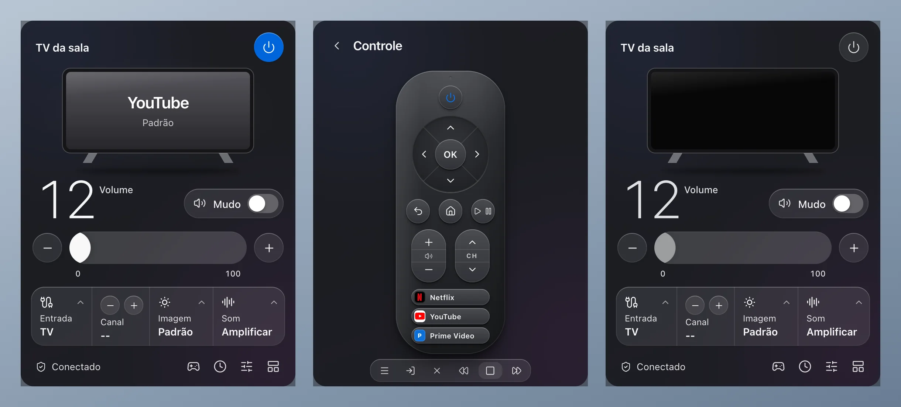
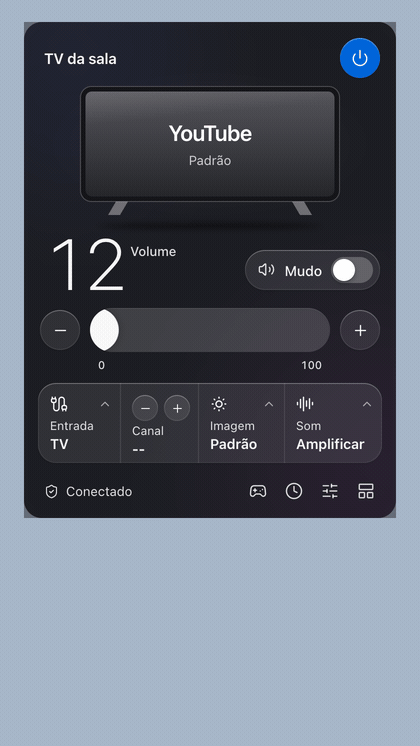
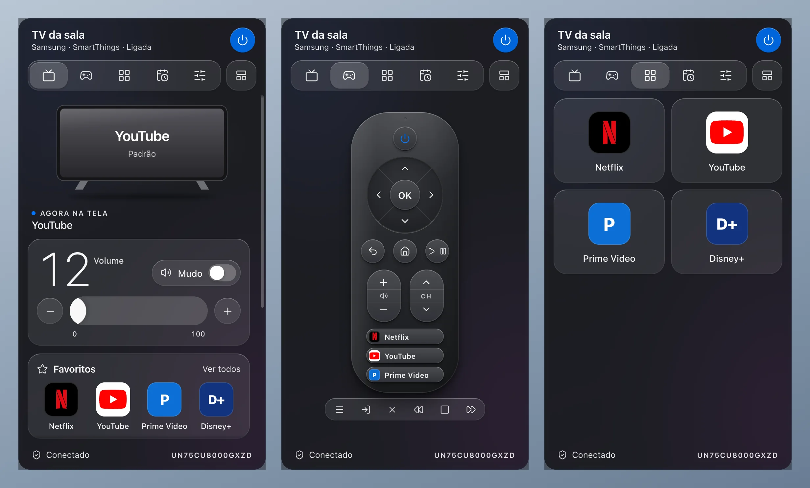
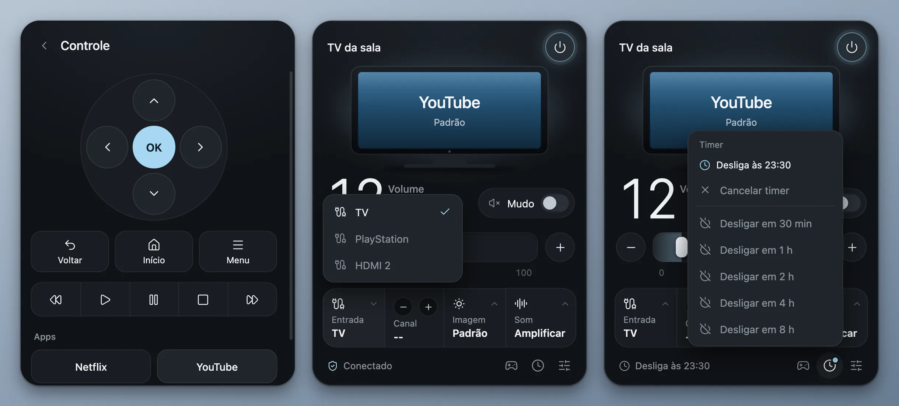
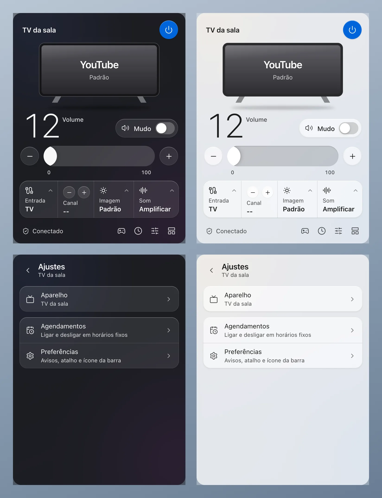
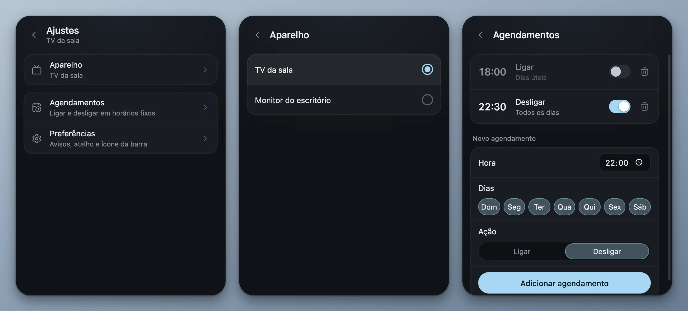

<p align="right"><b>Português</b> · <a href="README.en.md">English</a></p>

<div align="center">
  
  <h1>TV Remote</h1>
  <p>Controle a TV Samsung pela barra de menus do Mac, via SmartThings.</p>
</div>

<p align="center">
  <a href="https://github.com/kevinnfsilva/samsung-tv-menubar-app/releases/latest/download/TVRemote-arm64.dmg"></a>
  &nbsp;
  <a href="https://github.com/kevinnfsilva/samsung-tv-menubar-app/releases/latest/download/TVRemote-x64.dmg"></a>
</p>

<p align="center">
  <sub>Não sabe qual é o seu Mac? Menu Apple &gt; <b>Sobre Este Mac</b>: com "Chip" é Apple Silicon, com "Processador" é Intel. Precisa do macOS 13 ou mais novo. Para Windows, veja <a href="#no-windows">No Windows</a>.</sub>
</p>

<p align="center">
  <a href="https://kevinnfsilva.github.io/samsung-tv-menubar-app/">Página de download</a> ·
  <a href="https://github.com/kevinnfsilva/samsung-tv-menubar-app/releases/latest">Notas da versão</a>
</p>

<p align="center">Prefere instalar sem o aviso do macOS? Cole esta linha no Terminal:</p>

```sh
curl -fsSL https://raw.githubusercontent.com/kevinnfsilva/samsung-tv-menubar-app/main/install.sh | bash
```

<div align="center">
  <p>
    <a href="https://github.com/kevinnfsilva/samsung-tv-menubar-app/releases/latest"></a>
    
    
  </p>
  <p>
    <a href="#baixar-para-mac">Baixar para Mac</a> ·
    <a href="#o-que-dá-para-fazer">O que dá para fazer</a> ·
    <a href="#uso">Uso</a> ·
    <a href="#rodar-pelo-código-fonte">Código-fonte</a> ·
    <a href="#no-windows">Windows</a> ·
    <a href="#problemas-comuns">Problemas comuns</a>
  </p>
</div>

<p align="center">
  
</p>

Um painel na barra de menus do Mac para controlar uma TV Samsung pelo SmartThings. O ícone mostra o volume e, com um clique, abre o painel: ligar e desligar, volume, mudo, entrada, imagem, som, canal e um controle remoto desenhado, com atalhos para Netflix, YouTube, Prime Video e Disney+.

Este projeto nasceu do [WindFree](https://github.com/kevinnfsilva/samsung-windfree-menubar-app), o painel do ar-condicionado Samsung, e usa o mesmo código, com a parte da TV no lugar da parte do ar. O WindFree, por sua vez, é baseado no [app de bandeja para Windows](https://github.com/c0dag/samsung-windfree-tray-app) do [@c0dag](https://github.com/c0dag), que foi portado para a barra de menus do macOS.

<p align="center">
  
</p>

<p align="center"><sub>As imagens e a demonstração saem do código real do painel, com uma TV simulada. O ponteiro do vídeo foi desenhado por cima.</sub></p>

## Baixar para Mac

Você precisa de:

- macOS 13 ou mais novo
- A TV já configurada no app SmartThings, numa conta Samsung

Não precisa instalar o Node.js: o app instalado já traz tudo o que usa.

Escolha o arquivo do seu Mac. Os links sempre apontam para a última versão:

| Seu Mac | Arquivo |
|---|---|
| Apple Silicon (M1 ou mais novo) | [`TVRemote-arm64.dmg`](https://github.com/kevinnfsilva/samsung-tv-menubar-app/releases/latest/download/TVRemote-arm64.dmg) |
| Intel | [`TVRemote-x64.dmg`](https://github.com/kevinnfsilva/samsung-tv-menubar-app/releases/latest/download/TVRemote-x64.dmg) |

Na dúvida, abra o menu Apple e escolha **Sobre Este Mac**. Se aparecer "Chip", é Apple Silicon. Se aparecer "Processador", é Intel.

As mesmas opções, com explicações, estão na [página de download](https://kevinnfsilva.github.io/samsung-tv-menubar-app/). Há dois jeitos de instalar: pelo Terminal, sem o aviso do macOS, ou abrindo o DMG.

### Instalar pelo Terminal (sem avisos)

Cole esta linha no Terminal (em Aplicativos > Utilitários) e aperte Return:

```sh
curl -fsSL https://raw.githubusercontent.com/kevinnfsilva/samsung-tv-menubar-app/main/install.sh | bash
```

O script baixa o DMG certo para o seu Mac (Apple Silicon ou Intel), confere se o app dentro dele é o TV Remote, copia o **TV Remote.app** para a pasta **Aplicativos** e abre o app. Não usa `sudo` e não pede senha: se a pasta Aplicativos não aceitar gravação para o seu usuário, ele usa `~/Applications`. Se o TV Remote já estiver instalado, a cópia antiga é trocada. Com o app aberto, o script pede para ele sair e espera alguns segundos; se ele não sair, o script para sem mexer em nada e pede para você sair pelo menu do ícone.

**Por que isso evita o aviso?** O aviso do macOS vale só para arquivos com a marca de quarentena ("baixado da internet"), que os navegadores põem em tudo o que baixam. O `curl` não põe essa marca, então o app instalado assim abre normalmente. O app continua não notarizado; ele só não passa pelo bloqueio da primeira abertura.

O script é o [`install.sh`](install.sh), um texto simples que dá para ler antes de rodar. Ele só apaga as suas próprias pastas temporárias e a cópia anterior do `TV Remote.app`. Para testes ou espelhos, aceita três variáveis de ambiente: `TVREMOTE_DMG_URL` (baixa esse DMG, em vez do da última versão), `TVREMOTE_INSTALL_DIR` (instala nessa pasta, em vez de Aplicativos) e `TVREMOTE_NO_OPEN=1` (não abre o app no fim). As mensagens saem em português quando o idioma do Terminal (`LC_ALL`, `LC_MESSAGES` ou `LANG`) é português, e em inglês nos outros casos.

### Instalar pelo DMG

1. Abra o DMG e arraste o **TV Remote** para a pasta **Aplicativos**.
2. Abra o TV Remote pela pasta Aplicativos. Na primeira vez o macOS bloqueia; veja logo abaixo como liberar.
3. O painel abre na hora. O app fica com um ícone na barra de menus, perto do relógio, e outro no Dock. Para ficar só na barra de menus, desligue **Mostrar o ícone no Dock** em **Ajustes > Preferências**.

O app não se atualiza sozinho. Para trocar de versão, rode de novo o comando do Terminal acima. Ou saia do app, baixe o DMG novo e substitua o app na pasta Aplicativos; neste caso talvez seja preciso liberar a abertura de novo.

### Liberar a primeira abertura

Isto vale para o DMG baixado pelo navegador. Quem instala [pelo Terminal](#instalar-pelo-terminal-sem-avisos) não passa por aqui.

O TV Remote não é notarizado (autenticado) pela Apple. A notarização exige uma conta paga de desenvolvedor, que este projeto não tem, então o app sai só com uma assinatura local (ad-hoc). Por isso o macOS bloqueia a primeira abertura.

Para liberar:

1. Tente abrir o TV Remote e feche o aviso que aparece, sem mover o app para o Lixo.
2. Abra **Ajustes do Sistema > Privacidade e Segurança** e role até a parte de **Segurança**.
3. Clique em **Abrir Mesmo Assim** ao lado do aviso sobre o TV Remote e confirme com a senha ou o Touch ID.

Se preferir o Terminal, este comando remove o bloqueio:

```sh
xattr -dr com.apple.quarantine "/Applications/TV Remote.app"
```

Ele tira a marca de quarentena que o macOS põe nos arquivos baixados da internet. Depois disso o app abre normalmente.

Se não quiser confiar num app não notarizado, dá para [rodar pelo código-fonte](#rodar-pelo-código-fonte). É o mesmo programa.

### Primeiro uso

1. O painel abre com **Entre na conta Samsung**. Clique em **Entrar**.
2. O navegador abre com o login oficial do SmartThings. Entre e autorize. Enquanto isso o painel mostra "Aguardando o login no navegador…", com o botão **Cancelar**.
3. Quando o login termina, o app procura as TVs da conta e usa uma que esteja respondendo (ou a primeira da lista, se nenhuma responder). Se você tem mais de uma, escolha a certa em [**Ajustes > Aparelho**](#mais-de-uma-tv-na-mesma-conta). O ícone da barra de menus, que mostra `--` enquanto conecta, passa a mostrar o volume quando a TV está ligada.

O navegador só abre quando você clica em **Entrar**, no painel ou no menu do ícone. O app espera o login por cerca de 10 minutos; se passar disso, o painel volta para "Entre na conta Samsung". **Cancelar**, ou sair do app, encerra o login e não deixa nenhum processo em segundo plano. Essas duas garantias, de não abrir o navegador sozinho e de não deixar processos, valem só no Mac.

Depois disso o app abre sozinho com o macOS, sem abrir o painel. Dá para desligar no menu do ícone ou em **Ajustes > Preferências**.

Com a barra de menus cheia, o que é comum nos MacBooks com notch, o ícone novo pode ficar escondido. Segure ⌘ e arraste os ícones para reorganizar, ou feche algum que não usa. Clicar no ícone do app no Dock, ou abrir o TV Remote de novo pela pasta Aplicativos, também mostra o painel.

## O que dá para fazer

**Novidades da 0.2.0.** O painel usa o visual nativo do macOS: o material translúcido do sistema, os cantos e a sombra do sistema, controles no estilo da Central de Controle e uma só cor de destaque, a cor de destaque do sistema. O painel tem dois estilos, **Compacto** (o padrão) e **Abas**, trocados com um clique. O controle remoto agora é desenhado, nos dois estilos, com teclado próprio e uma luz que pisca a cada comando. Netflix e YouTube mostram a marca de cada app; Prime Video e Disney+ têm um selo desenhado. Há animações na abertura do painel, nos botões, na tela da TV, no volume, nos menus e nas trocas de página e de aba.

- Ligar e desligar a TV pelo botão do painel, pelo menu do ícone ou com a tecla Espaço.
- Ajustar o volume de 0 a 100 pelo controle deslizante, pelos botões − e + ou pelas setas ↑ e ↓. Ligar e desligar o mudo.
- Trocar a **entrada**, o **modo de imagem** e o **modo de som**. As opções são as que a TV informa.
- Trocar de canal com os botões − e + do cartão **Canal**, quando a TV informa o canal.
- Usar o **Controle** desenhado: direcional, OK, Voltar, Início, teclas de volume, de canal e de app, botões de reprodução, Menu, Fonte e Sair. Também dá para usar o teclado.
- Escolher o estilo do painel, **Compacto** ou **Abas**, com um clique.
- Programar um **timer** (de 30 minutos a 8 horas) e **agendamentos** por horário e dia da semana.
- Receber avisos: a TV ficar offline e a TV ficar ligada por muito tempo.
- Abrir o painel por um atalho global (desligado por padrão).
- Escolher a TV, quando a conta tem mais de uma.
- Aparência clara ou escura, seguindo o sistema, e telas em português ou inglês.
- Mostrar o volume no ícone da barra de menus, abrir com o macOS, esconder o ícone do Dock e saber quando sai uma versão nova.

Testado numa Samsung Crystal UHD de 75 polegadas (UN75CU8000) com o visual da 0.2.0: ligar e desligar pelo painel, trocar de estilo e as teclas de volume do controle desenhado. Continuam valendo os testes da 0.1.0, porque os comandos são os mesmos: ligar e desligar pela rede, volume, mudo, modo de imagem, modo de som, abrir YouTube e Netflix, a tecla Início e as teclas de canal funcionaram. As setas, Voltar e play/pause são enviadas, mas a TV não informa se a tela mudou. O modo de imagem só muda enquanto alguma coisa está tocando. Timer, agendamentos e avisos foram testados só com uma TV simulada. Os atalhos de Prime Video e Disney+ não foram testados na TV. O instalador para Intel e o Windows não foram executados.

## Uso

### O ícone na barra de menus

- Com a TV ligada, o ícone é uma TV cheia, seguida do volume. Desligada, é uma TV vazada, com um símbolo de liga e desliga, e sem número. Sem dados da TV (sem login ou antes da primeira leitura), é uma TV vazada com `--`.
- Com o mudo ligado, uma barra corta o desenho da TV.
- Deixe o mouse parado sobre o ícone para ver o nome da TV, se está ligada, o volume e a entrada.
- Clique no ícone para abrir o painel. Clique de novo, clique fora ou aperte Esc para fechar.
- Clique com o botão direito (ou com dois dedos no trackpad) para abrir o menu: **Abrir painel**, **Ligar** ou **Desligar**, **Mudo** (marcado quando está ligado), **Atualizar agora**, **Abrir com o macOS** e **Sair**. Sem login, o menu mostra **Entrar na conta Samsung** no lugar dos comandos da TV.
- Para mostrar ou esconder o volume no ícone, use **Mostrar o volume no ícone** em **Ajustes > Preferências**.
- Para fechar o app de vez, use **Sair** no menu do ícone.

### O painel

**Compacto** (o padrão) cabe numa tela só, de cima para baixo:

- O nome da TV e o botão que liga e desliga a TV.
- A tela da TV: mostra o app em uso (YouTube, Netflix e outros que o app reconhece) ou, se nenhum for reconhecido, a entrada, e embaixo o modo de imagem. Com a TV desligada, a tela fica escura.
- O volume em número grande, o interruptor **Mudo**, o controle deslizante e os botões − e +.
- Uma faixa com quatro células: **Entrada**, **Canal** (com − e +), **Imagem** e **Som**. Entrada, Imagem e Som abrem uma lista com as opções que a TV informa.
- O rodapé mostra o estado, como "Conectado", "Sincronizando…" ou "A TV está offline", e tem os botões **Controle**, **Timer**, **Ajustes** e o de layout (veja abaixo).

**Abas** é o mesmo painel com uma barra de abas de ícones (**Início**, **Controle**, **Apps**, **Rotinas** e **Ajustes**) e mais altura. Em **Início** ficam a TV, o volume, o cartão **Favoritos** (Netflix, YouTube, Prime Video e Disney+), o cartão **Entradas** e, mais abaixo, **Imagem** e **Som**. **Controle** é o controle remoto desenhado. **Apps** mostra os quatro apps em blocos. **Rotinas** tem o timer e os agendamentos. **Ajustes** tem **Aparelho** e **Preferências**. O rodapé mostra a conexão e o modelo da TV.

<p align="center">
  
</p>

Para trocar de estilo, use o botão de layout: no rodapé do Compacto, ou ao lado da barra de abas no Abas. A escolha também fica em **Ajustes > Preferências > Estilo do painel**, e o painel abre no estilo escolhido por último.

Quando algo dá errado, o rodapé diz o quê: "Sem internet ou SmartThings fora do ar", "A TV está offline", "Nenhuma TV nesta conta", "Esta TV não está mais na conta" (com o atalho **Escolher outra TV**), "O SmartThings demorou para responder" ou "Sem resposta do SmartThings". Quase todos trazem **Tentar de novo**. Quando a TV não confirma uma mudança, o rodapé diz quais ajustes ficaram sem confirmação.

### Controle

<p align="center">
  
</p>

O controle remoto é desenhado e aparece nos dois estilos: no Compacto, pelo botão **Controle** do rodapé; no Abas, pela aba **Controle**. Ele tem:

- Um botão de ligar e desligar no topo, e o direcional (↑, ←, OK, →, ↓).
- **Voltar**, **Início** e o botão de reproduzir ou pausar.
- Um balancim de volume (+ e −), com o **Mudo** no meio, e um balancim de canal (**CH** ↑ e ↓).
- Três teclas de app: **Netflix**, **YouTube** e **Prime Video**, que abrem o app na TV.
- Uma linha com **Menu**, **Fonte**, **Sair**, **Retroceder**, **Parar** e **Avançar**.
- Uma luz no topo que pisca a cada comando enviado.

O **Disney+** só aparece no Abas, nos **Favoritos** e na aba **Apps**. O Compacto não tem tecla para ele.

Com o controle aberto, o teclado manda:

| Tecla | Função |
|---|---|
| ↑ ↓ ← → | Direcional |
| Enter | OK (quando nenhum botão está com o foco) |
| Backspace | Voltar |
| Espaço | Reproduzir ou pausar (quando nenhum botão está com o foco) |
| + e − | Volume |
| M | Ligar ou desligar o mudo |

Cada toque vai para a TV na ordem em que foi dado. O Controle passa pelo SmartThings, então cada tecla leva um ou dois segundos; navegar em menus com as setas é mais lento que o controle físico.

### Timer e agendamentos

**Timer.** Clique no relógio do rodapé (no Compacto). No Abas, o timer fica na aba **Rotinas**. Com a TV ligada, as opções são "Desligar em 30 min", 1 h, 2 h, 4 h e 8 h; com a TV desligada, são as mesmas para ligar. O rodapé mostra "Desliga às…" ou "Liga às…" enquanto o timer está ativo, e **Cancelar timer** o desfaz. Só existe um timer por vez.

**Agendamentos.** Em **Ajustes > Agendamentos** (no Abas, na aba **Rotinas**), escolha a hora, os dias da semana e a ação (**Ligar** ou **Desligar**). Os dias podem ser todos, dias úteis, fins de semana ou uma combinação. Cada agendamento tem um botão para ativar ou desativar e uma lixeira.

Valem algumas regras para o timer e os agendamentos:

- Cada um fica ligado à TV que estava em uso quando foi criado e age sobre ela, mesmo que você escolha outra TV depois.
- Eles só rodam com o TV Remote aberto. Com o Mac em repouso, o app não age; um timer de desligar que venceu nesse período dispara quando o Mac acorda.
- Se o comando não puder ser entregue (sem internet, SmartThings fora do ar), o app tenta de novo a cada minuto, por até 10 minutos, e depois mostra um aviso de que não foi possível ligar ou desligar a TV. Se você fechar o app nesse tempo, ele retoma ao abrir de novo. Ligar ou desligar a TV à mão cancela as tentativas pendentes.
- Um timer de desligar que venceu com o Mac em repouso, ou com o app fechado, dispara assim que o app estiver rodando de novo. Um timer de ligar com mais de 5 minutos de atraso é descartado, e o app avisa.
- Um agendamento só dispara no minuto marcado. Se o app estiver fechado ou o Mac em repouso nesse minuto, ele não é recuperado.

### Avisos

Em **Ajustes > Preferências** dá para ligar ou desligar cada aviso:

- **Avisar se a TV ficar offline**: quando a TV perder a conexão.
- **Avisar se ficar ligada por**: Nunca, 4 h, 8 h ou 12 h.

Além desses, o app avisa sempre que um timer ou um agendamento não consegue ligar ou desligar a TV, e quando um timer de ligar é descartado por atraso. Esses avisos não têm opção para desligar.

### Atalhos

- O **Atalho global** abre e fecha o painel de qualquer lugar. Fica desligado até você ligar em **Ajustes > Preferências**. No Mac é ⌃⌥W (Control + Option + W). Se outro app já usa essa combinação, a chave volta a desligar e o painel avisa "Combinação em uso ou inválida.". Não dá para trocar a combinação pelo painel.
- Com o painel aberto, sem menu nem ajustes abertos: ↑ e ↓ mudam o volume de 1 em 1, **M** liga e desliga o mudo e **Espaço** liga e desliga a TV.
- **Esc** volta um passo: fecha o menu aberto, depois a página dos ajustes, depois os ajustes e por fim o painel.
- Logo depois de abrir, o painel ignora essas teclas por cerca de 0,7 segundo, e elas não valem enquanto a TV não está alcançável.

### Aparência e idioma

O painel acompanha o modo claro ou escuro do sistema.

<p align="center">
  
</p>

O material translúcido do painel é o desfoque clássico do macOS, não o "liquid glass" mais novo da Apple, que o Electron ainda não oferece. No modo escuro, sobre um fundo claro, o painel fica cinza médio.

O idioma fica em **Ajustes > Preferências > Idioma**: Automático, Português ou English. No Automático, o app usa português quando o macOS está em português e inglês em qualquer outro caso. O menu do ícone e os avisos seguem o mesmo idioma.

### Ajustes

<p align="center">
  
</p>

Em **Ajustes** ficam três páginas: **Aparelho** (a lista de TVs da conta), **Agendamentos** e **Preferências**. Preferências tem os avisos, o atalho global, o volume no ícone (só no Mac), **Mostrar o ícone no Dock** (só no Mac), **Abrir com o macOS**, **Procurar versões novas**, o **Estilo do painel** e o **Idioma**. No Abas, Ajustes mostra só **Aparelho** e **Preferências**; os agendamentos ficam na aba **Rotinas**.

### Versões novas

O app não se atualiza sozinho, mas avisa: ao abrir e depois uma vez por dia, ele consulta a página de versões do projeto no GitHub. Quando sai uma versão mais nova, aparece um ponto no botão de ajustes, uma linha no topo dos ajustes com o botão **Baixar** e um item no menu do ícone. O botão abre a página da versão; instalar continua com você. Para o app não fazer essa consulta, desligue **Procurar versões novas** em Preferências.

### Abrir com o macOS

Depois da primeira abertura o app passa a abrir sozinho quando você inicia a sessão no Mac, com o painel fechado. Para desligar, desmarque **Abrir com o macOS** no menu do ícone ou em **Ajustes > Preferências**.

Por baixo dos panos, é um LaunchAgent: o arquivo `~/Library/LaunchAgents/io.github.kevinnfsilva.tvremote.plist`. O macOS pode avisar que um item em segundo plano foi adicionado. Se mover o app de lugar, saia dele pelo menu **Sair** e abra de novo para atualizar o início automático.

## Mais de uma TV na mesma conta

Abra **Ajustes > Aparelho**. A lista mostra as TVs da conta; clique na que você quer controlar. Se a TV que você usava saiu da conta, o painel diz "Esta TV não está mais na conta" e o atalho **Escolher outra TV** leva até essa lista.

Monitores Samsung também aparecem na lista, porque o app reconhece qualquer aparelho com o recurso de canal de TV.

O app guarda a escolha no arquivo `device.json`. Você não precisa mexer nele, mas é bom saber onde fica:

- App instalado no Mac: `~/Library/Application Support/TV Remote/device.json`
- Rodando pelo código-fonte: `device.json` na pasta do projeto

Apagar o `device.json` faz o app procurar de novo e escolher uma TV da conta.

## Rodar pelo código-fonte

Funciona no Mac e no Windows. No Windows é o único jeito, porque não há instalador.

Requisitos:

- macOS 13 ou mais novo, ou Windows 10 ou 11
- [Node.js](https://nodejs.org) 24.8 ou mais novo (é o que o SmartThings CLI pede)
- A TV já configurada no app SmartThings, numa conta Samsung

Baixe o código:

```sh
git clone https://github.com/kevinnfsilva/samsung-tv-menubar-app.git
```

Entre na pasta:

```sh
cd samsung-tv-menubar-app
```

Instale as dependências:

```sh
npm install
```

Abra o app:

```sh
npm start
```

Sem git, baixe pelo botão **Code > Download ZIP**, extraia e rode `npm install` e `npm start` dentro da pasta.

O primeiro uso é igual ao do app instalado: o painel pede o login, você clica em **Entrar**, o app escolhe uma TV da conta e o ícone aparece. O `device.json` fica na pasta do projeto.

Depois disso ele abre sozinho com o sistema. Se mover a pasta de lugar, saia do app e rode `npm start` de novo para atualizar o início automático.

### Gerar os instaladores do Mac

Num Mac, depois do `npm install`:

```sh
npm run dist
```

Os arquivos `TVRemote-arm64.dmg` e `TVRemote-x64.dmg` saem na pasta `dist/`.

## No Windows

No Windows o app roda direto da pasta do projeto, com o Node.js. Não há instalador: siga os passos de [Rodar pelo código-fonte](#rodar-pelo-código-fonte).

**O Windows não foi testado nesta versão.** O código do painel de bandeja continua no projeto, mas ainda não foi executado.

- O ícone com o volume fica na bandeja, no canto do relógio. Ligada, a TV ganha um traço colorido embaixo do número; desligada, o ícone fica mais apagado.
- O Windows 11 esconde ícones novos na setinha ^ da bandeja. Para deixar o ícone sempre à vista, arraste-o para a barra ou ative em **Configurações > Personalização > Barra de tarefas > Outros ícones da bandeja**.
- Clique no ícone para abrir o painel. Clique fora ou aperte Esc para fechar.
- Clique com o botão direito no ícone para entrar na conta, ligar ou desligar, mudar o mudo, atualizar, escolher se abre com o Windows ou sair.
- O painel não abre sozinho quando você inicia o app, e não há ícone no Dock nem a opção de mostrá-lo. O atalho global, quando ligado, é Ctrl+Alt+Shift+W.
- Depois da primeira vez ele abre sozinho com o Windows. Se mover a pasta de lugar, rode `npm start` de novo para atualizar o início automático.

## Como funciona

- O app conversa com a TV pela API oficial do SmartThings, usando o login do [SmartThings CLI](https://github.com/SmartThingsCommunity/smartthings-cli). Esse login se renova sozinho e só pede para entrar de novo depois de 30 dias sem uso. Os tokens pessoais do SmartThings expiram em 24 horas, por isso o app não usa esse caminho. Não há modo de rede local: tudo passa pelos servidores do SmartThings.
- `tv.mjs` transforma as ações em comandos do SmartThings, confere se a TV aplicou cada ajuste e traduz as falhas em códigos de erro.
- `bridge.js` organiza a fila de comandos. Mudanças de volume seguidas viram um comando só; cada tecla do Controle e cada toque em Apps vira um comando, na ordem em que foi dado.
- `main.js` cuida do ícone, do painel, do início automático e dos avisos. A pasta `lib/` tem o timer, os agendamentos, os avisos e o atalho. A pasta `locales/` tem os textos em português e inglês, e `panel/` é a interface.
- O app relê o estado da TV a cada 15 segundos com o painel aberto e a cada minuto com ele fechado, para acompanhar o que muda por fora, como pelo controle remoto ou pelo app SmartThings. Sem login, ou depois de uma resposta lenta demais, ele para de ler sozinho até você tentar de novo.
- No Mac esses scripts rodam no Node que já vem dentro do Electron, por isso o app instalado não precisa do Node.js. No Windows o app usa o Node instalado no sistema.

Tudo roda no seu computador. O login do SmartThings CLI fica na pasta `~/Library/Application Support/@smartthings/cli` (no arquivo `credentials.json`). As configurações (preferências, timer e agendamentos) ficam em `settings.json`, na pasta de dados do app: no Mac, `~/Library/Application Support/TV Remote`. O app só fala com os servidores do SmartThings, da Samsung, e uma vez por dia pergunta ao GitHub se saiu uma versão nova (dá para desligar em **Preferências > Procurar versões novas**).

## Problemas comuns

- **O macOS não deixa abrir o app**: é o bloqueio de apps não notarizados. Veja [Liberar a primeira abertura](#liberar-a-primeira-abertura), ou instale [pelo Terminal](#instalar-pelo-terminal-sem-avisos), que não passa por ele. Se o aviso disser que o app "está danificado", use o comando `xattr` dessa mesma seção.
- **O ícone não aparece na barra de menus do Mac**: com a barra cheia ele pode estar escondido atrás do notch. Segure ⌘ e arraste os ícones para reorganizar, ou feche algum que não usa. Para chegar ao painel mesmo assim, clique no ícone do app no Dock ou abra o TV Remote de novo pela pasta Aplicativos.
- **Não quero o ícone no Dock**: desligue **Mostrar o ícone no Dock** em **Ajustes > Preferências**. O app fica só na barra de menus.
- **O painel não abriu quando liguei o Mac**: é de propósito. Aberto pelo início automático, o app fica quieto; clique no ícone da barra de menus.
- **O app não abriu sozinho com o macOS**: confira se **Abrir com o macOS** está marcado no menu do ícone. O início automático só é registrado com o app num lugar fixo, como a pasta Aplicativos. Se você abriu direto do DMG, saia do app pelo menu **Sair**, arraste para Aplicativos e abra de novo.
- **"Entre na conta Samsung"**: o app ainda não tem um login, ou o login expirou depois de 30 dias sem uso. Clique em **Entrar**. Se o navegador não abrir, ou você fechou a aba sem terminar, clique em **Cancelar** e em **Entrar** de novo.
- **"Sem internet ou SmartThings fora do ar"**: confira a conexão e o app SmartThings, e clique em **Tentar de novo**.
- **"O SmartThings demorou para responder"** ou **"Sem resposta do SmartThings"**: clique em **Tentar de novo**. Até lá o app não atualiza sozinho.
- **"A TV está offline"**: a TV perdeu a energia ou o Wi-Fi. Confira os dois; o app avisa quando ela voltar, se o aviso estiver ligado.
- **"Nenhuma TV nesta conta"**: o login precisa ser na mesma conta em que a TV aparece no app SmartThings.
- **"Esta TV não está mais na conta"**: clique em **Escolher outra TV** e escolha uma das que aparecem.
- **"A TV não confirmou: …"**: a TV recebeu a mudança, mas não mostrou o novo valor. A mensagem diz quais ajustes ficaram sem confirmação.
- **O atalho global não funciona**: outro app pode estar usando a combinação. O painel mostra "Combinação em uso ou inválida." e desliga a chave.

## Desinstalar

No Mac:

1. Desligue **Abrir com o macOS** no menu do ícone ou em **Ajustes > Preferências**.
2. Clique em **Sair** no menu do ícone.
3. Apague o TV Remote da pasta Aplicativos (ou de `~/Applications`, se o instalador do Terminal usou essa). Se você roda pelo código-fonte, apague a pasta do projeto.
4. Se quiser, apague também a pasta `~/Library/Application Support/TV Remote`, onde ficam o `device.json` do app instalado e as configurações, e as pastas `~/Library/Application Support/@smartthings/cli` e `~/Library/Preferences/@smartthings/cli`, onde o SmartThings CLI guarda o login e a configuração.

Apagou o app antes de desligar o início automático? Remova o arquivo que sobrou:

```sh
rm ~/Library/LaunchAgents/io.github.kevinnfsilva.tvremote.plist
```

No Windows, desligue "Abrir com o Windows" nos ajustes, clique em **Sair** no menu do ícone e apague a pasta.

## Créditos

- O código vem do [WindFree](https://github.com/kevinnfsilva/samsung-windfree-menubar-app), o painel do ar-condicionado Samsung do mesmo autor. O WindFree é baseado no app de bandeja para Windows, o [samsung-windfree-tray-app](https://github.com/c0dag/samsung-windfree-tray-app) do [@c0dag](https://github.com/c0dag).
- Marcas de Netflix e YouTube do [Simple Icons](https://simpleicons.org), sob licença CC0. As marcas pertencem aos seus donos.
- Ícones do [Lucide](https://lucide.dev).

Projeto independente, sem vínculo com a Samsung.
